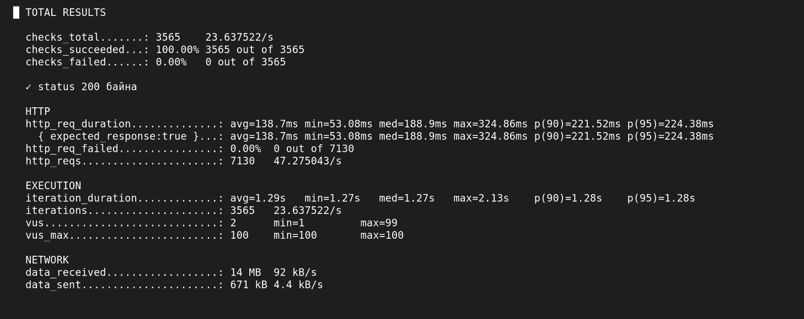

# B242270058

# Лаборатори №2: Гүйцэтгэлийн хэмжүүрийг k6-аар хэмжих

**Оюутан:** Н.Мөнхбаяр (B242270058) 
**9-р сарын хэмжилтийн хэрэгсэл:** Grafana k6 v2.2.0 (Windows) 
**11-р сарын stages хэмжилтийн хэрэгсэл:** Debian 13 Linux (`k6 version` бүтэн гаралтыг доор харуулав) 
**Тестийн бай:** https://test.k6.io

# Терминал дээр `k6 version` 

debain13@debian:~/B242270058$ k6 version
k6 v2.4.0 (commit/dd9395906d, go1.26.11, linux/amd64)
9 сард windows  ашиглаж байсан бол энэ удаа засвар хийх үедээ Ubuntu linux дээр хийсэн.

## Хэмжилтийн хүснэгт

| VU | p90 (ms) | p95 (ms) | Throughput (req/s)  | Error rate (%) |

|----|----------|----------|---------------------|----------------|

| 5  | 230.74   | 231.55   | 7.65                | 0.00           |

| 30 | 227.93   | 230.64   | 45.76               | 0.00           |

| 100| 227.70   | 228.92   | 152.50              | 0.00           |

## SLO үндэслэл

Baseline p95 = 227.67 ms байсан тул SLO-г 227.67 × 1.5 = 341.5 ms

(дугуйруулж 342 ms) гэж тодорхойлсон.

<<<<<<< HEAD
# Threshold үр дүн (Grafana k6 v2.2.0, Windows)
PASS: results/threshold-pass.txt — p(95) = 228.2 ms (тогтоосон босгыг хангаж PASS гарсан).
=======
<<<<<<< HEAD

=======
# Threshold үр дүн (Grafana k6 v2.2.0, Windows)
PASS: results/threshold-pass.txt — p(95) = 228.2 ms (тогтоосон босгыг хангаж PASS гарсан).
>>>>>>> ad62978 (readme zasvar)
>>>>>>> cc16d72 (readme zasvar)

FAIL: results/threshold-fail.txt — p(95) = 228.46 ms (хатуу тохируулсан босгоос давж FAIL гарсан).

Stages тестийн үр дүн (script-stages.js — Debian 13 Linux)
Гаралтын файл: results/run-stages.txt

Ажиллуулсан команд: k6 run script-stages.js | tee results/run-stages.txt

Үр дүн: 4 үе шаттайгаар (2m30s, хамгийн ихдээ 99 VU, vus_max=100) нийт 3,565 iteration, 7,130 HTTP хүсэлт (47.28 req/s) гүйцэтгэж, checks 100.00% амжилттай, алдааны хувь 0.00% гарсан. Хариу өгөх хугацаа avg = 138.7 ms, med = 188.9 ms, max = 324.86 ms, p(90) = 221.52 ms, p(95) = 224.38 ms болж SLO (p95 less than 342 ms) болон baseline (228.27 ms)-ийг бүрэн хангасан.

## Дүгнэлт

9-р сард Windows орчинд k6 v2.2.0 ашиглан хийсэн хэмжилтээр ачаалал 5 VU-аас 100 VU болж өсөхөд p95 latency 231.55 ms-аас 228.92 ms болж бараг өөрчлөгдөөгүй. Throughput 7.65 req/s-аас 152.50 req/s болж 20 дахин өссөн нь систем шугаман масштаблаж байгааг харуулж байна. Error rate бүх түвшинд 0.00% байсан нь POFOD-ийн аналог юм. Гэхдээ 100 VU-д med 188 ms, max 425 ms болж өссөн нь сүүлний latency нэмэгдэж байгааг харуулж байна. results/run-05vu-baseline.txt файл дахь бодит p95 = 228.27 ms baseline дээр үндэслэн тодорхойлсон SLO p95 less than 342 ms (228.27 × 1.5 = 342.4 ms) бүх түвшинд хангагдсан. Мөн threshold шалгалтаар PASS (228.2 ms) болон FAIL (228.46 ms) нөхцөлүүд хүлээгдэж буй хэмжээнд ажилласан. Шинээр Debian 13 Linux дээр ажиллуулсан script-stages.js (results/run-stages.txt) 4 үе шаттай 100 хүртэл VU ачааллын үед ч 0.00% алдаатай, p95 = 224.38 ms үзүүлэлттэй гарлаа. Иймд 100 VU хүртэл систем тогтвортой ажиллаж байгаа бөгөөд хэрэв 200-500 VU туршиж үзвэл хязгаарын цэг илрэх магадлалтай.
